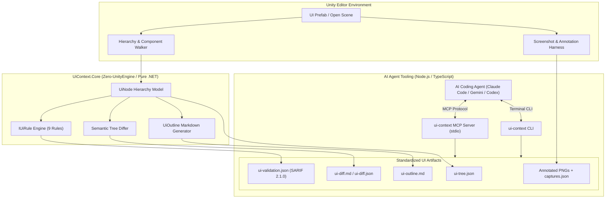

# unity-ui-agent-tools (UI Context)

[](https://github.com/thesanketkale/unity-ui-agent-tools/actions/workflows/ci.yml)
[](https://github.com/thesanketkale/unity-ui-agent-tools/releases)
[](LICENSE)
[](https://github.com/thesanketkale/unity-ui-agent-tools/actions/workflows/codeql.yml)

Unity editor package that exports uGUI hierarchies, prefab structure and annotated screenshots as agent-readable artefacts, with UI validation rules, a semantic diff and an MCP adapter for AI coding agents.

---

## 1. Why It Exists

AI coding assistants (Claude Code, GitHub Copilot, Codex CLI, and Gemini) excel at writing C# scripts but are fundamentally blind to Unity user interfaces. In Unity, layout geometry lives inside opaque serialized YAML prefab files, while visual results exist only in screen pixels.

### Comparison with Existing Alternatives
| Approach | Strengths | Limitations for AI Agents |
|---|---|---|
| **Manual Unity Inspector** | Native in-editor viewing | Inaccessible to terminal agents; lacks automated diffing and SARIF export |
| **Unity UI Toolkit Builder** | Modern visual stylesheet authoring | Irrelevant to the millions of existing uGUI / TextMeshPro projects; not machine-readable via CLI |
| **Figma / Design Specs** | Rich design representation | Divorced from Unity runtime rect math, CanvasScaler calculations, and serialized event bindings |
| **In-Game Debug Overlays** | Useful during playmode | Requires running game loop; cannot statically inspect prefabs or prevent broken builds in CI |
| **`unity-ui-agent-tools`** | **Deterministic JSON/Markdown, 9 SARIF rules, semantic diff, MCP server, zero-engine Core for CI** | **Focused on uGUI & TextMeshPro (UI Toolkit on roadmap)** |

---

## 2. Features

- **Exhaustive & Token-Saving Formats:** Generates full `ui-tree.json` and shorthand `ui-outline.md` (~80% token savings).
- **Automated Validation Engine:** 9 built-in rules flagging overlapping hitboxes, undersized targets, text overflow, and safe-area violations.
- **SARIF 2.1.0 Diagnostics:** Emits standard `ui-validation.json` directly ingestible by GitHub Code Scanning.
- **Semantic UI Diffing:** Detects moved, resized, text-changed, added, and removed elements between snapshots.
- **Model Context Protocol (MCP) Server:** Stdio adapter exposing `describe_ui`, `capture_ui`, `validate_ui`, and `diff_ui` to coding agents.
- **Zero-UnityEngine Core Library:** Compiles under pure .NET (`net8.0` / `netstandard2.1`) so 100% of rules and diffs run in hosted CI without Unity licenses.

---

## 3. Quickstart

Get from a clean machine to a running validation and diff in four commands:

```bash
# 1. Clone repository
git clone https://github.com/thesanketkale/unity-ui-agent-tools.git && cd unity-ui-agent-tools

# 2. Run pure .NET Core engine unit tests (22 tests, zero Unity license needed)
dotnet test tests/UiContext.Core.Tests/UiContext.Core.Tests.csproj -c Release

# 3. Build and test TypeScript CLI and MCP adapter
npm --prefix cli install && npm --prefix cli test

# 4. Compute semantic diff between sample snapshots
node cli/dist/cli.js diff tests/fixtures/golden-hud-tree.json tests/fixtures/golden-hud-tree.json
```

---

## 4. Architecture Overview



---

## 5. Configuration Reference (`.uicontext.json`)

| Property | Default | Purpose |
|---|---|---|
| `targetPlatform` | `"mobile"` | Accessibility target profile: `"desktop"` (32px), `"mobile"` (48px), or `"xr"` (64px) |
| `minInteractableWidth` | `48.0` | Minimum clickable/touchable width for selectable UI elements |
| `minInteractableHeight` | `48.0` | Minimum clickable/touchable height for selectable UI elements |
| `maxLayoutGroupDepth` | `3` | Maximum nesting levels of LayoutGroups before raising performance warnings |
| `checkNonInteractiveRaycasts` | `true` | Flags `Image` or `Text` elements wasting raycasts with `raycastTarget=true` |
| `failOnDuplicateSiblingNames` | `true` | Prevents sibling GameObjects from sharing identical names |
| `ruleSeverities` | `{ ... }` | Override individual rule severities (`"error"`, `"warning"`, `"note"`, `"off"`) |

---

## 6. Usage Examples

### Inspecting UI with AI Agents via MCP
Add the MCP server to Claude Code or Antigravity:
```json
{
  "mcpServers": {
    "unity-ui-context": {
      "command": "node",
      "args": ["<path-to-repo>/cli/dist/mcp-server.js"]
    }
  }
}
```
Prompt: `"Describe the UI layout of the HUD prefab using describe_ui and list all buttons."`

### EditMode Automated Test Integration
Projects can enforce UI rules directly inside Unity EditMode tests using `UiContextAssert`:
```csharp
[Test]
public void SettingsDialog_PassesAccessibilityRules()
{
    var prefab = AssetDatabase.LoadAssetAtPath<GameObject>("Assets/Prefabs/SettingsDialog.prefab");
    var tree = UiHierarchyWalker.ExtractTree(prefab);
    var result = new RuleRegistry().Validate(tree);
    
    UiContextAssert.NoErrors(result);
}
```

---

## 7. Troubleshooting and FAQ

**Q: Why does my headless batchmode build fail to capture screenshots?**  
A: Visual screenshot rendering (`UiScreenshotHarness`) requires an active GPU graphics device context. Unity batchmode running with `-nographics` cannot render camera render-textures. Run visual capture on a machine with display support.

**Q: Can I run UI validation if the Unity Editor has the project locked?**  
A: Yes! Use the in-editor localhost bridge (`Tools > UI Context > Start Local Agent Bridge`) on `http://127.0.0.1:49152`, or run validation on pre-exported `ui-tree.json` files using the CLI tool.

---

## 8. Security Notes and Known Limitations

- **Least-Privilege CI:** All GitHub Actions workflows operate with `permissions: {}` top-level defaults, granting only minimal required job permissions (`contents: read`).
- **Clean-Room Assurance:** Contains zero proprietary assets or private client names.
- **Scope:** Covers uGUI and TextMeshPro on Unity 2022.3 LTS and Unity 6 LTS. UI Toolkit is on the roadmap.

---

## 9. Verification Status

| Capability | Proved By | Status |
|---|---|---|
| **Core Data Models & Hierarchy Serialization** | Hosted CI (`dotnet test net8.0`) | :white_check_mark: Automated |
| **All 9 UI Validation Rules (Positive & Negative)** | Hosted CI (`dotnet test net8.0`) | :white_check_mark: Automated |
| **Semantic Tree Differ & Markdown Formatter** | Hosted CI (`dotnet test net8.0`) | :white_check_mark: Automated |
| **TypeScript CLI, MCP Protocol, & Schema Tests** | Hosted CI (`npm test`, Vitest, ajv) | :white_check_mark: Automated |
| **Secret Scanning & Clean-Room Verification** | Hosted CI (Gitleaks, CodeQL, guard.sh) | :white_check_mark: Automated |
| **Unity Editor GUI & Batchmode Execution** | Local Unity Editor (`Projects/Sample`) | :wrench: **Owner-Verified** (See [verification log](docs/verification-log.md)) |
| **GPU Visual Screenshot Rendering** | Local Unity with active graphics device | :wrench: **Owner-Verified** (See [verification log](docs/verification-log.md)) |

---

## 10. Roadmap

- [x] **v0.1.0:** Core uGUI hierarchy export, 9 validation rules, SARIF 2.1.0 output, semantic diff, MCP adapter.
- [ ] **v0.2.0:** Multi-resolution GPU screenshot harness with numbered bounding boxes and visual punch lists.
- [ ] **v0.3.0:** Live bi-directional Unity Editor bridge with interactive element highlighting.
- [ ] **v0.4.0:** UI Toolkit (`UIDocument`, UXML, USS) support.

---

## 11. Related Projects, Contributing, and Licence

### Related Projects
- [`unity-openxr-foundation`](https://github.com/thesanketkale/unity-openxr-foundation): Production OpenXR template project for standalone XR headsets.
- [`unity-build-pipeline`](https://github.com/thesanketkale/unity-build-pipeline): Self-hosted GitHub Actions build, test, and release pipeline for Unity.

### Contributing
Contributions are welcome! Please read [CONTRIBUTING.md](CONTRIBUTING.md) and [CODE_OF_CONDUCT.md](CODE_OF_CONDUCT.md) before opening a pull request.

### Licence
Released under the [MIT Licence](LICENSE).  
Copyright &copy; 2026 Sanket Kale.
