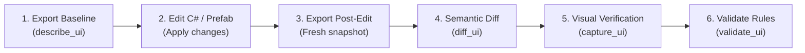

# AI Coding Agent Guidelines for Unity UI Context

This guide defines the standardized workflow for autonomous AI coding agents (Claude Code, GitHub Copilot, OpenAI Codex CLI, Google Gemini CLI) working in Unity repositories equipped with `unity-ui-agent-tools`.

## The 6-Step Agent Loop

When creating, refactoring, or debugging Unity UI prefabs, agents must adhere to the **Export -> Edit -> Export -> Diff -> Capture -> Validate** lifecycle:



### 1. Export Baseline
Before modifying any UI prefab or script, inspect the current layout state using the MCP tool:
```json
{
  "tool": "describe_ui",
  "arguments": { "targetPath": "ui-context-out/ui-outline.md" }
}
```
*Token discipline:* Prefer `ui-outline.md` over raw `ui-tree.json` for reading hierarchies. The outline uses shorthand anchor notation (`[stretch-stretch]`, `[top-left]`) and component badges (`[BTN]`, `[TXT]`) that consume ~80% fewer prompt tokens.

### 2. Edit
Perform your code or asset edits:
- Adjust serialized values in `.prefab` YAML or modify MonoBehaviour UI controller scripts.
- Never edit binary `.asset` files by hand.
- Respect anchor constraints when adjusting rect positions.

### 3. Export Post-Edit
Generate the new UI snapshot:
- **If Unity Editor is closed:** Run batchmode CLI export:
  ```bash
  "$UNITY_PATH" -batchmode -nographics -projectPath . -executeMethod UiContext.Cli.Export -uiContext.target Assets/Prefabs/Target.prefab -uiContext.out ui-context-out/after
  ```
- **If Unity Editor is open:** The local editor bridge serves the request over localhost `http://127.0.0.1:49152/`.

### 4. Semantic Diff
Call `diff_ui` to verify that your changes affected only intended nodes and components:
```json
{
  "tool": "diff_ui",
  "arguments": {
    "beforePath": "ui-context-out/before/ui-tree.json",
    "afterPath": "ui-context-out/after/ui-tree.json"
  }
}
```
Review the Markdown table for unexpected side effects (e.g., unintended sibling resizing or accidental offset shifts).

### 5. Visual Capture
Call `capture_ui` to check rendered screenshot outputs:
```json
{
  "tool": "capture_ui",
  "arguments": { "targetPath": "ui-context-out/after/captures.json" }
}
```
Cross-reference numbered bounding boxes with the coordinate legend to confirm visual balance and alignment across resolutions.

### 6. Validate Rules
Run the diagnostics engine to guarantee no regression against the 9 UI quality rules:
```json
{
  "tool": "validate_ui",
  "arguments": { "targetPath": "ui-context-out/after/ui-validation.json" }
}
```
A successful validation must contain **0 errors**. Fix any overlapping hitboxes (`UI002`), touch target size violations (`UI003`), or layout group nesting spikes (`UI007`) before submitting.
