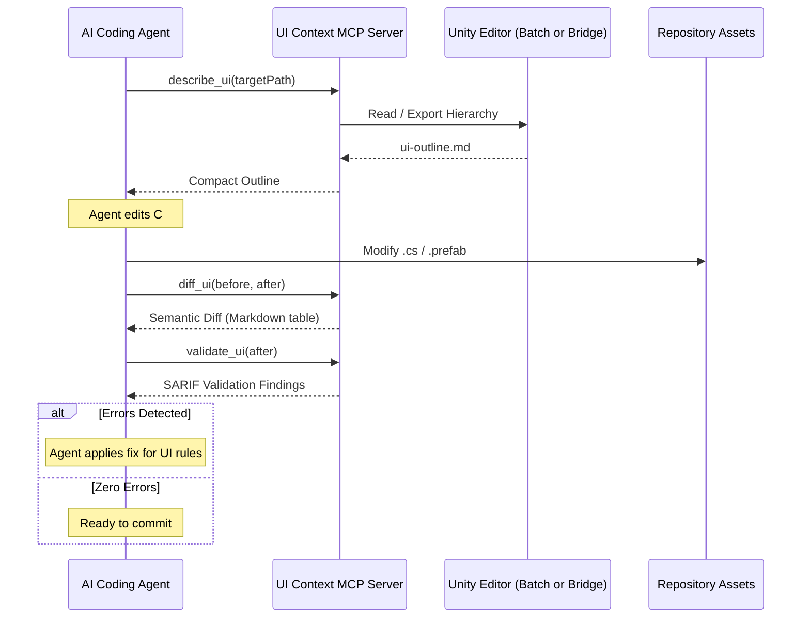

# AI Agent Workflows for Unity UI

This document details the operational loop used by AI coding agents when developing or modifying Unity UI with `unity-ui-agent-tools`.

## The Core Loop

## Token Optimization Best Practices
1. **Always Request `ui-outline.md` First:** When analyzing an unfamiliar prefab, ask for the outline rather than `ui-tree.json`. It provides essential layout information, active states, text strings, and listener calls with ~80% fewer tokens.
2. **Use Semantic Diffs for Verification:** Never prompt yourself with the full before and after JSON trees to see changes. The `diff_ui` tool highlights precisely what moved, resized, or changed.
3. **Automate with `UiContextAssert` in EditMode Tests:** Add `UiContextAssert.NoErrors(result)` into your EditMode test suites to lock in accessibility and structural constraints during CI.
