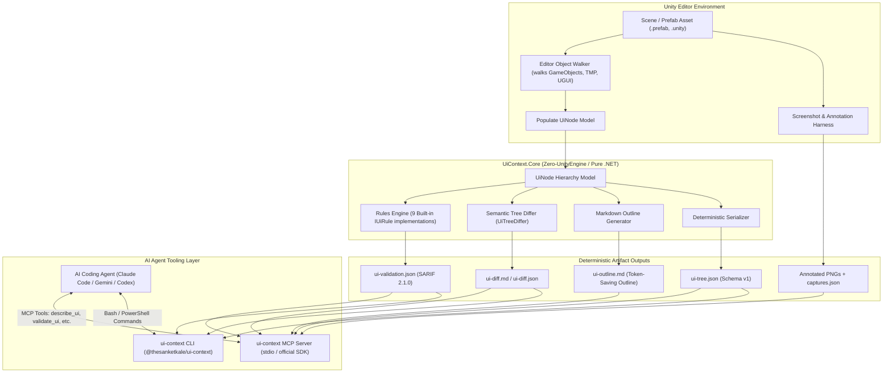

# System Architecture: unity-ui-agent-tools (UI Context)

## 1. Executive Overview

AI coding agents (such as Claude Code, GitHub Copilot, Codex, and Gemini CLI) excel at synthesizing and refactoring C# code. However, when working within Unity projects, they face a severe perceptual barrier: **UI layouts exist primarily as serialized YAML prefab assets and visual pixel arrangements on screen**.

`unity-ui-agent-tools` provides a deterministic pipeline that bridges Unity's uGUI system and AI agents:
1. **Introspection:** Extracts RectTransform hierarchies, component configurations, TextMeshPro contents, layout parameters, and event hooks into standard, machine-readable representations (`ui-tree.json`, `ui-outline.md`).
2. **Diagnostics:** Runs a high-performance rules engine against the hierarchy to flag common structural flaws (missing references, overlapping hitboxes, undersized targets, text overflow, safe-area violations) as standard SARIF 2.1.0 reports (`ui-validation.json`).
3. **Change Detection:** Computes semantic diffs between UI snapshots to highlight relocated, resized, added, removed, or restyled nodes in Markdown format (`ui-diff.md`).
4. **Agent Protocol (MCP):** Exposes high-level tools via the Model Context Protocol (`describe_ui`, `capture_ui`, `validate_ui`, `diff_ui`) allowing agents to query and verify UI states interactively.

---

## 2. High-Level Architecture Diagram

---

## 3. Subsystem Breakdown

### 3.1. Core Domain Layer (`Packages/io.github.thesanketkale.ui-context/Core`)
The Core library contains all data models, validation algorithms, serialization logic, and diff calculators.
- **Strict Dependency Rule:** Contains **zero** references to `UnityEngine`, `UnityEditor`, or any game engine assembly.
- **Multi-Targeting:** Compiles against `netstandard2.1` (for runtime assembly compatibility with Unity 2022.3 LTS and Unity 6) and `net8.0` (for high-throughput unit testing in standard CI).
- **Determinism:** All node traversals, child lists, and dictionary keys are sorted deterministically so identical prefab structures yield bit-for-bit identical JSON and Markdown hashes.

### 3.2. Unity Editor Assembly (`Packages/io.github.thesanketkale.ui-context/Editor`)
The Editor assembly interfaces directly with Unity's internal object model:
- **Object Walkers:** Reads `RectTransform`, `Canvas`, `CanvasScaler`, `Image`, `RawImage`, `TMP_Text`, `Text`, `Button`, `Toggle`, `Slider`, `Scrollbar`, `Dropdown`, `InputField`, `ScrollRect`, `LayoutGroup`, `ContentSizeFitter`, and `CanvasGroup`.
- **Persistent Listeners:** Extracts UnityEvent callbacks on buttons/toggles, identifying target object names, method signatures, and argument states.
- **Prefab Variant Tracking:** Detects prefab instance root linkage and summarizes modified property overrides.
- **Batchmode CLI Entry Point:** Implements `UiContext.Cli.Export` supporting automated execution from external CLI tools (`Unity -batchmode -projectPath ... -executeMethod UiContext.Cli.Export`).
- **Screenshot Harness:** Renders prefab instances into an offscreen render texture across configurable aspect ratios and scales, drawing numbered bounding boxes and generating coordinate legends for visual inspection.

### 3.3. TypeScript CLI & MCP Server (`cli/`)
Built with Node.js and TypeScript using the official `@modelcontextprotocol/sdk`:
- **CLI Commands:** `ui-context export`, `ui-context validate`, `ui-context diff`, `ui-context capture`.
- **MCP Server:** Runs over `stdio`, exposing:
  - `describe_ui`: Returns compact Markdown hierarchy outline and active component inventory.
  - `validate_ui`: Runs validation checks and returns concise SARIF diagnostics.
  - `diff_ui`: Compares two exported UI tree snapshots and formats semantic differences.
  - `capture_ui`: Triggers or retrieves rendered screenshot annotations and legends.

---

## 4. Architectural Boundaries and Invariants

1. **Clean-Room Boundary:** All sample scenes, prefabs, and fixture data are synthetically generated. No proprietary corporate assets or third-party copyrighted packages are bundled.
2. **Context Efficiency:** The outline generator (`ui-outline.md`) compresses a 200-node hierarchy into under 1,500 tokens by omitting default zero-offsets and condensing layout anchors into shorthand notation (e.g., `[stretch-stretch]`, `[top-left]`).
3. **Non-Destructive Guarantee:** All inspection, batchmode exports, and screenshot previews operate strictly read-only on cloned instances; source assets on disk are never altered.
